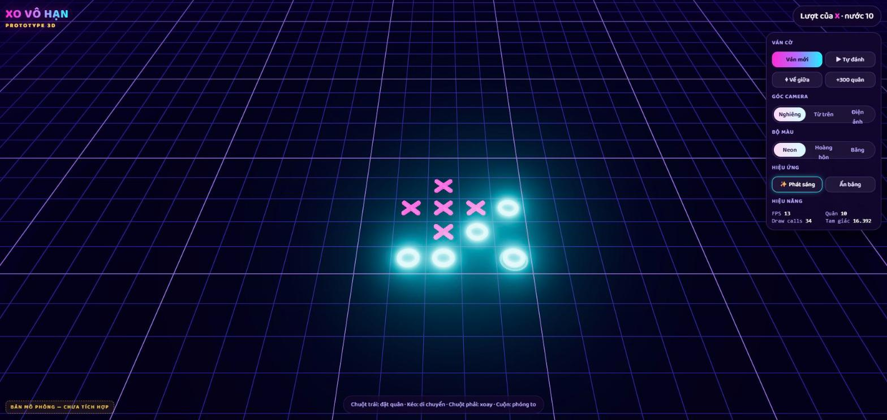
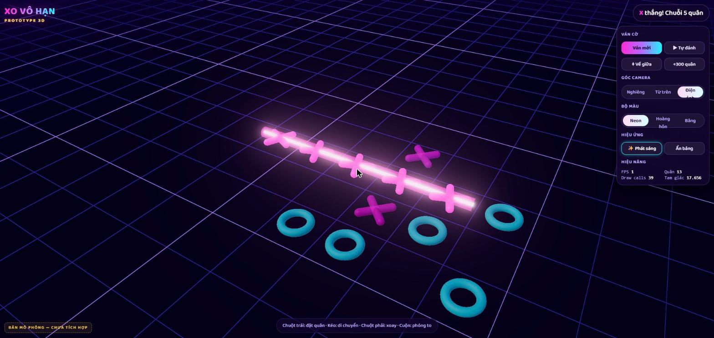
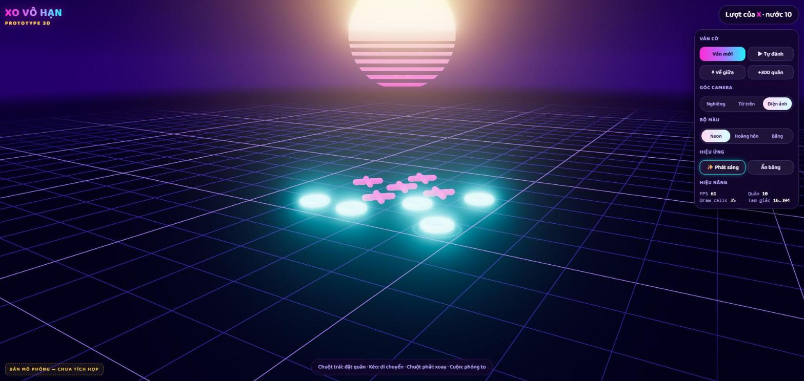
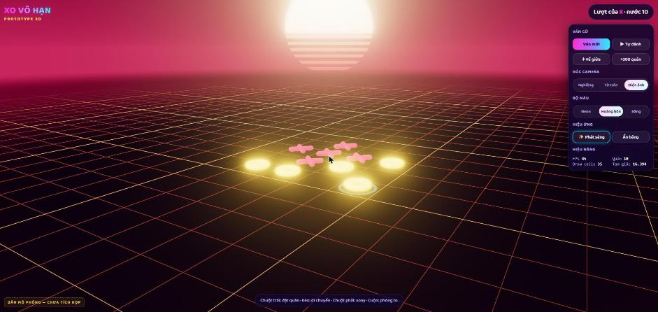
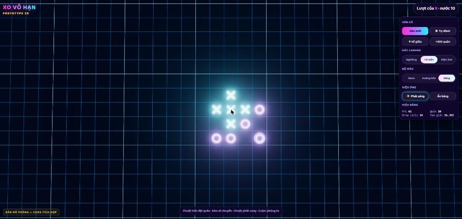
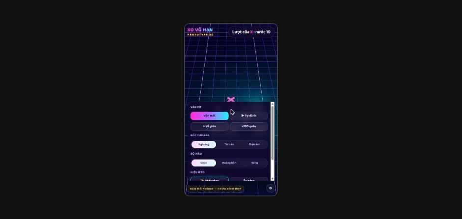

# Bản 3D

> Trạng thái: **đã tích hợp vào game** (nhánh `feat/3d`). Trang prototype `proto3d.html` đã được gỡ.

## Dùng thế nào

- Nút **3D** trên thanh trên cùng (cạnh nút Hồ sơ) để chuyển sang 3D; bấm lại (**2D**) để quay về. Chuyển được **giữa ván**, kể cả khi đang đánh online, vì renderer chỉ đọc `Game`.
- Lựa chọn được lưu trong `localStorage` (`infinite-xo:settings` → `view`, `cam3d`, `theme3d`, `glow3d`); mở lại game sẽ vào đúng chế độ đã chọn.
- Ở chế độ 3D có thêm nút ⬡ (dưới nút ⌖) mở **Cài đặt 3D**: góc camera, bộ màu, hiệu ứng phát sáng. Đổi là áp dụng ngay.
- **Mặc định:** camera **Nghiêng**, bộ màu **Neon**, phát sáng (bloom) **Tắt**.
- Three.js chỉ tải khi bật 3D lần đầu (chunk riêng ≈ 148 KB gzip); bản 2D vẫn ≈ 49 KB gzip. Máy không có WebGL sẽ báo và giữ 2D.

## Ảnh

| | |
|---|---|
|  **Neon – Nghiêng** (đề xuất mặc định) |  **Khoảnh khắc thắng**: tia laser nối chuỗi, quân thắng nhảy + xoay, quân còn lại tối đi, camera tự bay tới |
|  **Neon – Điện ảnh**: đường chân trời, mặt trời synthwave kẻ sọc, sương |  **Hoàng hôn** |
|  **Băng – Từ trên** (gần giống bản 2D) |  **Điện thoại 390px** (bảng điều khiển của prototype, bản thật dùng HUD hiện có) |

## Thiết kế

**Thế giới**
- Bàn vô hạn là **một mặt phẳng duy nhất chạy theo camera**. Lưới vẽ bằng shader: vạch mảnh mỗi ô, vạch đậm mỗi 5 ô (giống bản 2D), mờ dần ra xa rồi tan vào sương chân trời. Kéo đi bao xa cũng không có mép.
- Bầu trời gradient, ~900 ngôi sao, **mặt trời synthwave kẻ sọc** luôn nằm giữa chân trời theo hướng nhìn.

**Quân cờ**
- Dựng hoàn toàn bằng code, không dùng file model nào. X là 2 thanh capsule bắt chéo; O là vòng xuyến (torus). Vật liệu tự phát sáng màu neon.
- **Đặt quân:** quân rơi từ trên xuống, nảy nhẹ khi chạm bàn, có vòng sóng lan ra trên mặt bàn.
- **Rê chuột:** hiện quân mờ lơ lửng, xoay nhẹ, kèm ô sáng; vòng sáng nhấp nháy dưới nước vừa đánh.
- **Thắng:** tia laser trắng kèm quầng màu người thắng chạy dọc chuỗi (đủ dài kể cả >5 quân); các quân thắng nhảy lần lượt rồi xoay chậm; quân khác tối đi; bắn hạt; camera bay tới khung cả chuỗi.

**Điều khiển** (giống bản 2D để người chơi không phải học lại)
- Chuột trái: bấm = đặt quân, kéo = trượt bàn.
- Cuộn chuột: phóng to/thu nhỏ. Chuột phải: xoay.
- Cảm ứng: 1 ngón kéo, 2 ngón phóng to/xoay.
- Góc nghiêng bị giới hạn để không bao giờ nhìn xuống dưới mặt bàn.
- Xác định ô được bấm bằng cách chiếu tia chuột lên mặt phẳng bàn, không cần kiểm tra từng ô.

## Đo hiệu năng (máy test: GTX 1650, 1920×911)

| Trường hợp | Thời gian GPU / khung hình | Ghi chú |
|---|---|---|
| 10 quân, có bloom | **0,28 ms** | dư sức 60 FPS (ngân sách 16,7 ms) |
| 10 quân, không bloom | 0,16 ms | |
| 310 quân, có bloom | 0,40 ms | |
| FPS thực tế khi cửa sổ đang hiển thị | **61** | |

- Draw call: 34–54 lệnh vẽ với 10 quân. Mỗi X là 2 mesh, mỗi O là 1 mesh. Nếu **300 quân cùng nằm trong khung nhìn** sẽ lên khoảng 450 lệnh vẽ, vẫn ổn trên máy tính nhưng nặng cho điện thoại yếu. Bản thật sẽ gộp bằng `InstancedMesh` (2 lệnh vẽ cho mọi quân X, 1 cho mọi quân O).
- **Dung lượng:** Three.js + bloom ≈ **150 KB gzip**. Sẽ chỉ tải khi người chơi bật 3D (dynamic import), nên game 2D vẫn ~44 KB gzip như bây giờ.
- Chưa đo trên điện thoại thật. Bloom tốn nhiều băng thông điểm ảnh nhất, nên bản thật sẽ có chế độ chất lượng tự hạ khi FPS thấp (tắt bloom, giảm độ phân giải).

## Đã làm khi tích hợp

- `src/view3d/ThreeView.ts` cài interface `BoardView` giống `CanvasView`: `onCellTap`, `setInteractive`, `showHint` (cột sáng vàng), `reject` (chớp đỏ), `recenter`, `zoomBy`, `destroy`.
- Mũi tên chỉ nước cuối khi nằm ngoài khung nhìn (lớp HTML trên canvas).
- Chất lượng tự động: 3 giây liền FPS thấp thì tắt bloom và hạ độ phân giải.
- Tôn trọng `prefers-reduced-motion`: tắt nảy/rung/bay camera.
- `App.setViewMode('2d' | '3d')` huỷ view cũ, tạo view mới trên cùng `Game`.

## Chưa làm

- Gộp quân bằng `InstancedMesh`: hiện mỗi X là 2 mesh, mỗi O là 1 mesh. Ván thường (< 100 quân) không thành vấn đề; ván rất dài trên điện thoại yếu có thể nặng.
- Chưa đo trên điện thoại thật.
